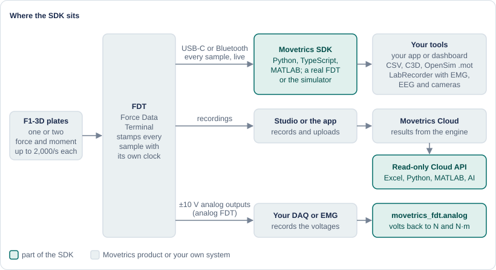
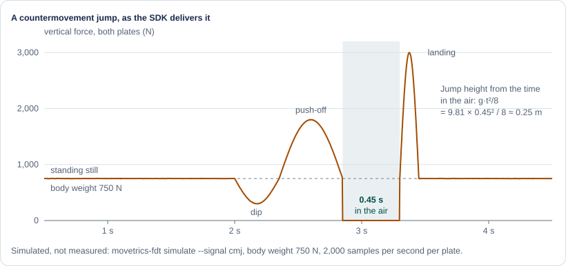
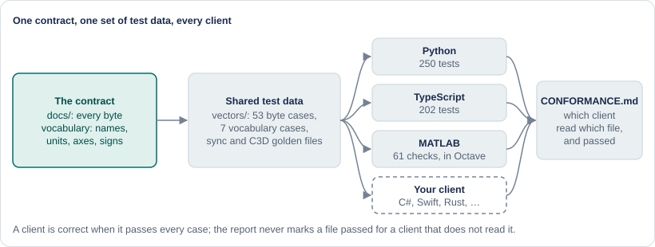

# Movetrics SDK

**Force plate data in the tools you already use.** F1-3D force plates measure how a person pushes on the ground, up to 2,000 times a second per plate. This SDK gets that data into Excel, Python, MATLAB, OpenSim, Lab Streaming Layer, a browser, your own app, or an AI assistant, with the same names, units and clock everywhere. Free and open under Apache 2.0.



**Docs: [developers.movetrics.com](https://developers.movetrics.com)** · **Building with an AI assistant? Paste the [start prompt](START_PROMPT.md).** · **New here? [The SDK in two minutes](https://developers.movetrics.com/start/two-minutes/)**

## Try it in one minute, no plate needed

```sh
pip install "movetrics-fdt[serial] @ git+https://github.com/movetrics/sdk#subdirectory=python"
movetrics-fdt simulate --tcp 7800 --signal cmj      # a virtual FDT with someone jumping on it
```

```python
import asyncio
from movetrics_fdt import FdtClient, TcpTransport, Sample

async def main():
    async with FdtClient(TcpTransport("127.0.0.1", 7800)) as fdt:   # real FDT: SerialTransport("COM3")
        await fdt.set_rate(2000)
        await fdt.start_stream()
        async for s in fdt.samples():
            if isinstance(s, Sample) and s.plate == 1 and s.stamp % 1000 == 0:   # every 0.1 s
                print(f"t={s.t:5.1f} s   fz={s.fz:6.0f} N")
            if getattr(s, "t", 0) > 4:
                break
        await fdt.stop_stream()

asyncio.run(main())
```

Run it in a second terminal. Plate 1 carries about 380 N, half of the virtual person's 750 N. At t = 2 s they dip (about 150 N), push off (about 860 N), leave the ground for 0.45 s (0 N) and land (a spike above 1,300 N). 



Plug in an FDT, change one line, and the same program reads real plates. Other extras: `ble` for Bluetooth, `c3d` for C3D files, `lsl` for Lab Streaming Layer.

## Pick your path

| You want | Go to |
|---|---|
| Results and recordings from Movetrics Cloud in a spreadsheet | [Excel in 5 minutes](https://developers.movetrics.com/start/excel/) |
| Live data or Studio files in Python or MATLAB | [Python](https://developers.movetrics.com/start/python/) · [MATLAB](https://developers.movetrics.com/start/matlab/) |
| Plates next to EMG, EEG or cameras, with sync | [Record with EMG and cameras](https://developers.movetrics.com/start/emg-and-cameras/) |
| C3D and external loads for OpenSim, Visual3D, Pose2Sim | [OpenSim and Pose2Sim](https://developers.movetrics.com/start/opensim/) |
| A browser app (Web Serial, Web Bluetooth) | [`ts/`](ts/) and [`examples/web/`](examples/web/) |
| A client in another language | The [specification](docs/) and the [test vectors](vectors/) |
| An AI assistant that builds it for you | [START_PROMPT.md](START_PROMPT.md), context in [AGENTS.md](AGENTS.md) |

## Why you can trust the numbers



- **One contract, three clients, the same test data.** Python and TypeScript pass all 53 byte-level cases; all three clients pass the checksum, stream, vocabulary and sync cases they read. [CONFORMANCE.md](CONFORMANCE.md) shows which client reads which file. A client you write in any other language is correct when it passes them too.
- **Checked against references outside the SDK (measured).** Centre of pressure within 0.28 mm rms of Studio's own figures on real recordings; C3D files read by ezc3d, the library OpenSim uses, within 0.24 to 0.29 mm rms.
- **Safe by construction.** The clients send eight commands: start, stop, rate, status, version, keep-alive, and set and read the sync mode. Firmware updates, calibration writes and resets are refused before a byte leaves the computer.
- **Nothing hidden.** Time comes from the FDT's clock, gaps are reported and never filled, and every Cloud result names the method and version that computed it.
- **Honest status.** This version has run against the simulator, recorded bytes and real Studio exports; the run against a real FDT is next. Every page says which: measured, simulated, or not yet. [What has been tested](https://developers.movetrics.com/concepts/tested/)

## What is in this repository

| Folder | What it holds |
|---|---|
| [`python/`](python/) | Python package `movetrics-fdt`: live client (USB, Bluetooth, TCP), Studio readers, CSV/C3D/OpenSim writers, LSL, sync alignment, simulator, Cloud client. Core uses only the standard library. |
| [`ts/`](ts/) | TypeScript package `movetrics-fdt-sdk`: browser and Node client, no runtime dependencies. |
| [`matlab/`](matlab/) | MATLAB toolbox `+movetrics`: live stream, Studio files, Cloud API. |
| [`excel/`](excel/) | Ready workbook and Power Query code for Movetrics Cloud. |
| [`examples/`](examples/) | Small complete programs: stream reader, recorder, LSL outlet, Cloud results, browser page. |
| [the firmware](docs/) | The specification: transports, framing, commands, the stream, status, vocabulary, files, sync, analog outputs. |
| [`vectors/`](vectors/) | Shared test vectors: the bytes in, the values out. |
| [`contracts/`](contracts/) | Machine-readable contracts: vocabulary, firmware capabilities, analog scale, Cloud API (OpenAPI). |
| [`site/`](site/) | The source of developers.movetrics.com. |

## Run the tests

From the repository root:

```sh
(cd python && python3 -m unittest discover -s tests -t .)
(cd ts && npm install && npm test)
(cd matlab && octave-cli --eval "run tests/run_tests.m")
```

## Licence, security, contributing

Apache 2.0, see [LICENSE](LICENSE) and [NOTICE](NOTICE). Report a vulnerability privately as described in [SECURITY.md](SECURITY.md). Issues and pull requests are welcome; [CONTRIBUTING.md](CONTRIBUTING.md) explains how changes are checked. The F1-3D plates and the FDT are made by Nur Engineering GmbH; Movetrics makes the software. The Movetrics name and logo in `site/` are trademarks and are not covered by the Apache licence; the fonts there carry their own SIL Open Font Licence files.
