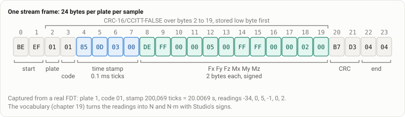

# Test vectors

These JSON files are the machine-readable contract of the FDT host link. Each case is an input and the exact output a client must produce from it. A client conforms when it passes every case in every file. The Python and TypeScript clients run all of them; the MATLAB toolbox runs the checksum, stream, vocabulary and sync files, the parts it uses. [`CONFORMANCE.md`](../CONFORMANCE.md) records which client reads which file.

If you write a client in another language, these files are your finish line.

## Files

| File | Cases | Anchors | Derived | Covers |
| --- | ---: | ---: | ---: | --- |
| `crc16.json` | 6 | 2 | 4 | CRC-16/CCITT-FALSE, low byte stored first |
| `host_frames.json` | 24 | 9 | 15 | host-to-FDT frames: encode, the receive delimiter, decode, NACKs |
| `stream_frames.json` | 13 | 6 | 7 | the 24-byte stream frame, including bad CRC and bad header |
| `status.json` | 6 | 1 | 5 | GET_STATUS replies: the 85-byte class and the 86-byte record, one record per plate |
| `ota_frames.json` | 4 | 2 | 2 | GET_FW_VERSION probe and replies, the bridge STOP frame |
| **byte-level total** | **53** | **20** | **33** | |
| `vocabulary.json` | 7 | | | frames in; the samples, gaps and events every client must make of them ([chapter 19](../docs/19-vocabulary-and-units.md)) |

Two more golden files live with the tests: `python/tests/fixtures/sync_events.json` (sync event frames and the GET_SYNC_MODE reply, read by all three clients) and `python/tests/fixtures/k5_c3d_cop.json` (the centre of pressure a C3D reader must find in a file this SDK writes).

## Two kinds of case

- **anchor**: external truth. Bytes captured from a real FDT, or a published check value (the CRC-16/CCITT-FALSE of ASCII `123456789` is `0x29B1`). An anchor is never typed by hand.
- **derived**: computed from the frame layouts and rules in the firmware source by a generator, never by a client. Cases with chosen inputs (a sample with readings 1234, -5678, ...) check that the layout and the CRC round-trip; the inputs are recorded in the case.

`vocabulary.json` is a third kind: its expected values are computed by [`tools/gen_vocabulary_vectors.py`](../tools/gen_vocabulary_vectors.py) from the formulas in [`contracts/vocabulary.v1.json`](../contracts/vocabulary.v1.json), not from any client.

## Case format

Each file has exactly these top-level keys, in this order: `schema` (`movetrics-fdt-vectors/1`), `file`, `description`, `cases`. Each case starts with `id` (kebab-case, unique across all files), `kind` (`anchor` or `derived`), `description` and `source`, then the fields of its file.

- Hex fields end in `_hex`, lowercase, no spaces; an empty payload is `""`. `rx_messages_hex` is a list of them.
- Command bytes written as text are two hex digits, for example `22`. Byte values in `fields`, `field_offsets` and `crc_covers` are decimal integers. `0x` appears only in `description`.

Fields by file:

- `crc16.json`: `input_hex`, `crc_hex`, `stored_hex` (the two bytes on the wire, low byte first), and `frame_hex` where a whole frame is shown.
- `host_frames.json`: encode cases have `command`, `address_hex`, `destination_hex`, `payload_hex` and `expect_frame_hex`; the one refused request has `expect_frame_hex: null`, `expect_error` and `would_be_frame_hex`. Decode cases have `frame_hex`, `rx_messages_hex` (the messages the receive delimiter delivers, in order) and `expect` with `valid`, `command`, `payload_hex` and `device_reply` (`{"nack_code": n}`, `{"reply": "command_reply"}` or `{"reply": "none", "reason": ...}`).
- `stream_frames.json`: anchors have `frame_hex` and `expect` (`valid`, `command`). Derived decodes have `expect.fields` (`platform_address`, `commandCode`, `timeStamp`, `forceX` ... `momentZ`). Negative cases have `expect.valid: false` and `expect.reason` (`crc_mismatch` or `bad_header`). The encode case has `expect_frame_hex`.
- `status.json`: `frame_hex`, `expect_length_class` (`85`, `86`, `86x3`), `fields`, and `expect`. The three-record reply has `records`, one object per 86-byte record.
- `ota_frames.json`: `frame_hex`, `crc_stored_hex`, `crc_covers` (`first` and `last` byte index, inclusive), `fields` where the frame has a layout, and `expect`.

## Things a client must get right

- Stream frames with stamp 0 at the start of a stream are placeholders, not measurements ([chapter 05](../docs/05-measurement-stream.md)).
- A GET_STATUS reply is a general record followed by one record per plate, so a full reply is 86 × (1 + plates) bytes. Some older readers accept only 85 bytes; the vectors say which form each case is.
- The receive delimiter splits on `04 04`, so a request to address `FF`/`FF` cannot be sent; `host_frames.json` records the refusal.

## What is not covered

Physical units and calibration: the vectors hold wire integers. Units, signs and the centre of pressure are the vocabulary's job ([chapter 19](../docs/19-vocabulary-and-units.md), `vocabulary.json`). Commands the clients do not send (firmware update, calibration, the plate bus inside the FDT) have no public vectors.
